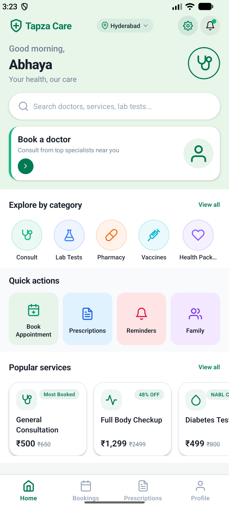
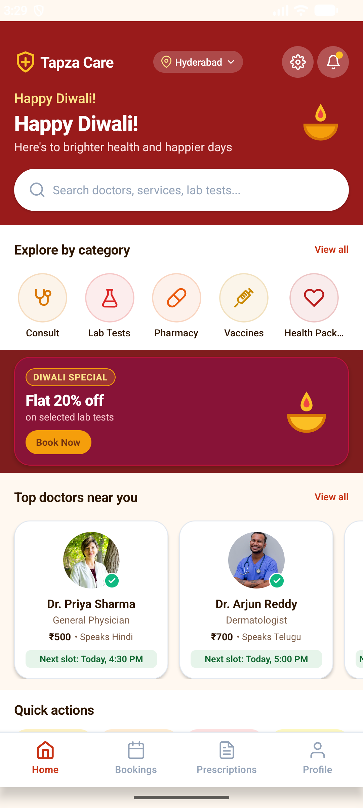
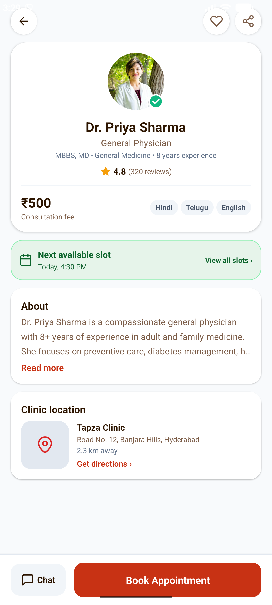
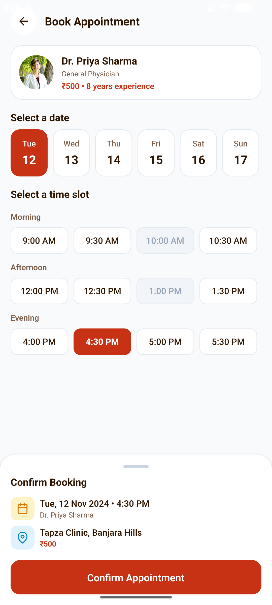
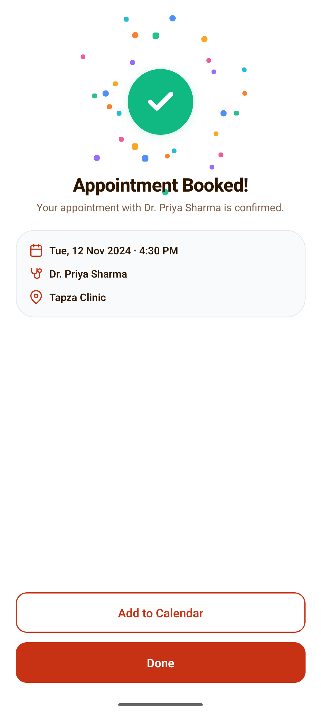
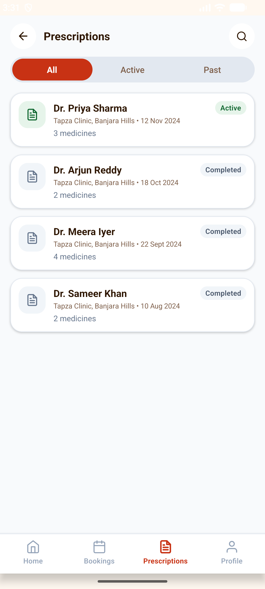
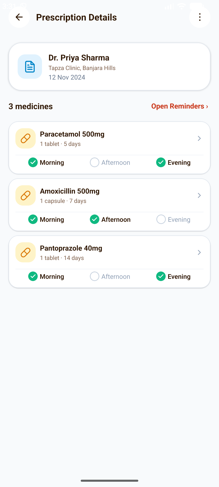
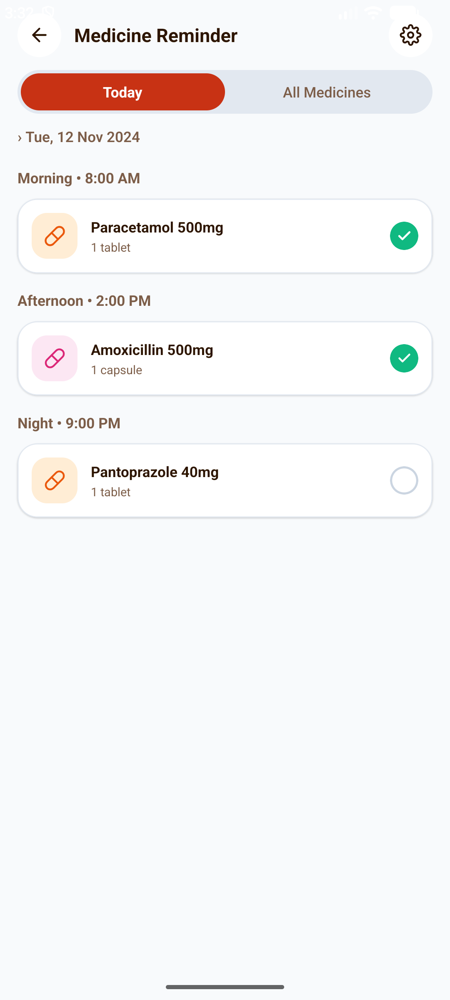

# Tapza Care — Patient Mobile App (React Native)

> **Tapza Technologies Mobile Engineer Assignment**  
> Patient app for Indian clinics: prescriptions, medicine reminders, doctor slot booking, and quick-commerce style healthcare discovery.

---

## 📱 App Highlights & Visual Showcase

Tapza Care implements a **Zepto/Blinkit-style server-driven home feed** where sections appear as you scroll, each styled with its own background colors, padding, and layout rules driven by a remote configuration that an administrator can update for festivals without an app release.

| 1. Normal Day Home | 2. Diwali Festival Home | 3. Doctor Profile | 4. Slot Booking |
| :---: | :---: | :---: | :---: |
|  |  |  |  |

| 5. Booking Confirmation | 6. Prescriptions List | 7. Prescription Details | 8. Medicine Reminders |
| :---: | :---: | :---: | :---: |
|  |  |  |  |

---

## 🛠️ Tech Stack & Prerequisites

- **Framework**: React Native 0.88 with New Architecture (Fabric)
- **Language**: Strict TypeScript
- **Package Manager**: `bun` (v1.4+)
- **Target Platform**: Android (Tested on Android 15 / API 35 `Medium_Phone` emulator and physical devices)
- **State & Storage**: React Context + `@react-native-async-storage/async-storage`
- **Testing**: Jest (`bun run test`)
- **Prebuilt APK**: `docs/TapzaCare-debug.apk` (140 MB)
- **Demo Video**: `docs/demo.mp4`

---

## 🚀 Quick Start Guide

### 1. Install Dependencies
```bash
# Using bun as required by core engineering standards
bun install
```

### 2. Run Android Dev Build
Ensure an Android emulator is running or an Android phone with USB debugging is connected:
```bash
# Verify connected device
adb devices

# Start Metro Bundler
bun run start

# In another terminal tab, build and launch on Android:
bun run android
```

### 3. Install Pre-built Debug APK Directly
If you want to test the app without building from source:
```bash
adb install -r docs/TapzaCare-debug.apk
adb shell am start -n com.tapzacare/.MainActivity
```

### 4. Run Test Suite
```bash
bun run test
```
*Executes all 4 unit test suites covering remote config validation, resilient slot booking with 409 conflict rollbacks, dynamic section rendering, and app boot.*

---

## 🏗️ Architectural Decisions

### 1. Zepto-Style Server-Driven Dynamic Feed
Instead of hardcoding the layout, the home feed is parsed and rendered dynamically via `src/components/sections/SectionRenderer.tsx`.
- **Dynamic Configuration**: The server returns a list of polymorphic sections (`hero_banner`, `category_chips`, `quick_actions`, `service_grid`, `doctor_carousel`, `offer_strip`).
- **Resilient Fallback**: If an admin pushes an unrecognized section type from a future app version, `SectionRenderer` gracefully ignores it (`return null;`) and continues rendering all sibling sections without crashing.
- **Theme Injection**: Section background colors, gradient stops, borders, and text colors are sourced directly from the active theme configuration tokens.

### 2. Festival Theming Engine (Remote Config without App Release)
- The app supports instant festival re-theming. When switching between **Normal Day** (Emerald Green `#007A55`) and **Diwali Festival** (Deep Crimson/Saffron `#8B1111` with warm amber accents):
  - Theme tokens (`theme.primary`, `theme.background`, `theme.surface`) update globally.
  - Festival-specific visual motifs activate automatically (e.g., traditional Indian glowing Diya oil lamps, Diwali promotional offer strips).
  - Can be changed via remote config API, or live inside the app via the **Dev Admin & Resilience Panel** (accessible via the gear icon in the header).

### 3. Resilient Booking Flow with Optimistic Updates & 409 Conflict Rollback
Clinic appointment booking in India suffers from concurrent booking race conditions when multiple patients or receptionists claim the same popular morning doctor slot.
- **Optimistic Reconciliation**:
  1. The user taps a slot (e.g., `09:00 AM`). The UI immediately marks it as selected and updates local state.
  2. When the user taps "Confirm Appointment", the app dispatches an asynchronous reservation request.
  3. If another patient reserved the slot in the meantime, the mock backend returns a `409 Conflict: Slot has already been booked`.
  4. The client catches the 409, rolls back the optimistic booking, invalidates the local slot cache, displays a clear actionable warning banner (`"This slot was just taken by another patient. Please select an alternate slot."`), and refreshes the slot list with taken slots disabled.

### 4. Offline First & Stale-While-Revalidate Fallback
- Every successful remote configuration and booking is persisted to `AsyncStorage`.
- When an API request fails due to network outage or a 500 error from the clinic server, the app falls back to the cached layout configuration and presents an unobtrusive warning banner (`"Could not refresh remote configuration. Displaying saved offline layout."`).

### 5. Indian Healthcare UX & Accessibility
- **Target Audience**: Designed specifically for Indian patients and their families on mid-range Android phones, many of them older, with varying digital literacy and visual acuity.
- **44pt Touch Targets**: All interactive elements (slots, date chips, category circles, medicine checkboxes, and CTA buttons) enforce a minimum touch target size of 44pt to prevent mis-clicks.
- **Accessible Typography**: High-contrast text ratios adhering to WCAG AA, with `allowFontScaling={true}` enabled across all text elements.
- **Indian Pricing & Localization**: Clear ₹ (INR) pricing, clinic landmarking (Banjara Hills, Hyderabad), and multi-language support (English, Hindi हिन्दी, Telugu తెలుగు).

---

## 🎛️ In-App Dev Admin & Chaos Panel

The app includes an in-app developer drawer for live reviewer testing without restarting the app:
1. **Tap the Gear Icon (⚙️)** in the top right header of the Home screen.
2. **Features Available**:
   - **Theme Switcher**: Instant toggle between `Normal Day` and `Diwali Festival`.
   - **Multi-Language**: Instant toggle between `English`, `हिन्दी`, and `తెలుగు`.
   - **Simulated Latency**: Throttle mock network latency (`0ms`, `400ms`, `1500ms`, `3000ms`) to test shimmer skeleton loading states.
   - **Failure Injections**:
     - *Force Config 500 Error*: Tests remote config failure and cached layout fallback.
     - *Force Slot Conflict (409)*: Tests optimistic booking rollback and conflict banner.
     - *Force Empty State*: Tests zero-data states.
     - *Simulate Offline Mode*: Simulates complete mobile network disconnect.
   - **Live JSON Config Editor**: Paste custom layout JSON directly into the app and see the UI update instantly.

---

## 📁 Repository Structure

```text
TapzaCare/
├── App.tsx                           # App bootstrap with ThemeProvider & I18nProvider
├── __tests__/                        # Comprehensive unit tests
│   ├── config.test.ts                # Remote config schema validation tests
│   ├── sectionRenderer.test.tsx      # Dynamic section renderer & unknown type tests
│   ├── booking.test.ts               # Slot booking & 409 conflict rollback tests
│   └── App.test.tsx                  # Root mount smoke test
├── docs/                             # Documentation, APK, and assets
│   ├── TapzaCare-debug.apk           # Installable Android debug APK (140 MB)
│   ├── demo.mp4                      # Video walkthrough demo
│   └── screenshots/                  # High-resolution screenshots of all 8 screens
├── src/
│   ├── api/                          # Mock backend client & offline storage
│   │   ├── mockClient.ts             # Mock REST API with chaos injection
│   │   ├── mockData.ts               # Realistic Hyderabad clinic data & configs
│   │   └── storage.ts                # AsyncStorage persistence layer
│   ├── components/
│   │   ├── common/                   # Core design system primitives (Icon, Button, Badge, Skeleton, Confetti)
│   │   ├── sections/                 # Dynamic section components (Hero, Chips, QuickActions, Grid, Carousel)
│   │   └── admin/                    # DevAdminModal chaos & theme drawer
│   ├── i18n/                         # Localization (English, Hindi, Telugu)
│   ├── navigation/                   # AppNavigator coordinating screens & bottom tabs
│   ├── screens/                      # 8 Production screens matching the mockup
│   │   ├── HomeScreen.tsx            # Zepto-style config-driven feed
│   │   ├── DoctorDetailScreen.tsx    # Doctor profile & clinic map card
│   │   ├── BookingScreen.tsx         # Date picker, slot grid & gesture bottom sheet
│   │   ├── BookingSuccessScreen.tsx  # Confetti celebration & calendar CTA
│   │   ├── PrescriptionsScreen.tsx   # Prescription list with status pills
│   │   ├── PrescriptionDetailScreen.tsx # Medicine dosage & schedule timeline
│   │   ├── MedicineRemindersScreen.tsx  # Interactive morning/afternoon/night dose checks
│   │   ├── BookingsScreen.tsx        # Appointments tab
│   │   └── ProfileScreen.tsx         # User profile tab
│   ├── theme/                        # Design tokens & dynamic ThemeProvider
│   └── types/                        # Strict centralized TypeScript types
├── AI_LOG.md                         # Detailed AI collaboration and prompt log
└── README.md                         # This file
```

---

## 🧪 Running Unit Tests

```bash
bun run test
```

Expected output:
```text
PASS __tests__/sectionRenderer.test.tsx
PASS __tests__/App.test.tsx
PASS __tests__/booking.test.ts
PASS __tests__/config.test.ts

Test Suites: 4 passed, 4 total
Tests:       9 passed, 9 total
Snapshots:   0 total
Time:        0.772 s
```

---

## 📄 License & Attribution
Created for the **Tapza Technologies Mobile Engineer Assignment**. Built with React Native and TypeScript.
